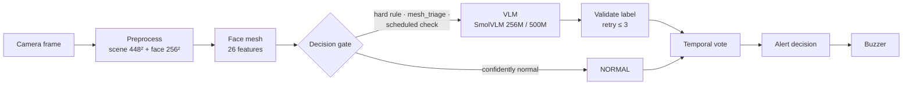

# EdgeVLM-Drive

**Resource-aware vision-language driver monitoring on NVIDIA Jetson Nano**

[](https://github.com/Norhankamal/EdgeVLM-Drive/actions/workflows/ci.yml)


EdgeVLM-Drive classifies a driver's state from a single in-cabin camera frame into **NORMAL**,
**DROWSY**, **LOOKING_AWAY** or **PHONE_USAGE** with a compact vision-language model (SmolVLM).
Inference runs entirely on an original 4 GB NVIDIA Jetson Nano: no cloud round trip, and no
driver-facing video leaves the cabin. A face-mesh decision gate, a scheduled safety check and a
temporal alert layer wrap the model into a complete monitoring pipeline.

<p align="center"><i>Paper:</i> EdgeVLM-Drive: Resource-Aware Vision-Language Driver Monitoring on NVIDIA Jetson Nano
 · Queen's University, School of Computing</p>

## Highlights

| | |
|---|---|
| **Accuracy on the device** | 82.83 % accuracy / 83.01 % macro-F1 (256M) on a balanced 1,200-image set, 100 % valid outputs |
| **Footprint** | 724 MB peak GPU memory (256M, 489 MB package) · 1,217 MB (500M, 968 MB package) |
| **Offline accuracy** | 80.18 % macro-F1, 86.22 % accuracy (500M, refined protocol, 5,558 test images) |
| **Drowsiness** | DROWSY recall 88.9 % [86.6, 90.8] on NTHU-DDD frames; 74 % → 80 % macro-F1 from the DMD-only model to the extended-data model |
| **Safety-aware gating** | Any-doubt triage skips only frames that look clearly attentive: 15 unsafe frames passed instead of 229 for rules alone |
| **Verifiable** | headline metrics are recomputed from the stored confusion matrices by the test suite (`pytest`) |

## Approach

1. **Dual-crop input.** Each frame becomes a 448×448 *full-scene* view (hands, lap, phone) and a
   256×256 *face* crop (eyelids, head pose). Training reuses the preprocessing of the deployed
   pipeline, so the model is trained on the pixels it sees at inference.
2. **LoRA on the vision encoder and the text decoder.** Adapting the vision encoder lets the model
   learn a new visual cue such as eye closure instead of only re-mapping cues it already sees.
3. **Checkpoint selection by validation macro-F1.** A callback runs real `generate()` calls on a
   fixed, class-balanced validation subset after every epoch and keeps the best macro-F1 adapter, so
   a model cannot win by favouring NORMAL.
4. **Resource-aware cascade.** A MediaPipe face mesh (26 features, ≈ 115 ms on CPU) gates the VLM.
   Any doubtful reading calls the VLM, a time-based scheduled check bounds how long a phone event
   can stay unseen, and a temporal layer turns per-frame labels into alerts.



The merged model is exported as a standalone **FP16 PyTorch / safetensors** package (no PEFT at
runtime). Runtime choices for the Jetson are in [`docs/jetson_deployment.md`](docs/jetson_deployment.md);
the gate and alert layer are described in [`docs/mesh_gate.md`](docs/mesh_gate.md).

## Results

### Development progression (offline, GPU server)

| Step | Model | Test images | Macro-F1 | Note |
|---|---|---:|---:|---|
| Instruction-only prompts | SmolVLM-256M | – | ≤ 21.11 % | best of four prompts |
| Single-crop LoRA | SmolVLM-256M | 3,579 | 50.78 – 55.51 % | text-decoder LoRA |
| Dual-crop, vision + text LoRA | SmolVLM-500M | 3,579 | **74.13 %** | balanced acc. 74.84 % |
| + NTHU-DDD and DrivFace data | SmolVLM-500M | 5,558 | 79.56 % | LoRA r = 16 |
| + refined protocol | SmolVLM-500M | 5,558 | **80.18 %** | acc. 86.22 %, balanced acc. 80.08 % |
| 256M dual-crop series | SmolVLM-256M | 5,558 | 78.16 → 79.63 → **80.61 %** | baseline → revised → MediaPipe-guided |

The 3,579-image and 5,558-image test sets differ (the extended set adds drowsiness and normal
frames), so numbers are compared within a test set. Stored metrics:
[`results/smolvlm_500m`](results/smolvlm_500m) · [`results/smolvlm_256m`](results/smolvlm_256m).

DROWSY recall of the refined model by source: **88.9 %** [86.6, 90.8] on NTHU-DDD frames and
**40.5 %** [33.3, 48.0] on DMD driving frames. Real-driving drowsiness is the priority for further
data collection.

### On the Jetson Nano 4 GB (balanced 1,200-image set, 300 per class)

| | SmolVLM-256M | SmolVLM-500M |
|---|---:|---:|
| Accuracy [95 % CI] | **82.83 %** [80.6, 84.9] | 79.08 % [76.7, 81.3] |
| Macro-F1 | **83.01 %** | 79.57 % |
| Unsafe frames labelled NORMAL | **11.67 %** | 18.56 % |
| False-alarm rate | 15.00 % | 10.33 % |
| Valid outputs | 100 % | 100 % |
| Latency, mean (P95) | **6.8 s** (7.5 s) | 7.9 s (8.7 s) |
| Peak GPU memory | **724 MB** | 1,217 MB |

The 256M model is more accurate (paired exact test, p = 4.5 × 10⁻⁵), misses fewer unsafe frames,
is faster and needs about 40 % less GPU memory. At 7 – 8 s per frame the system targets states that
persist for seconds: drowsiness, sustained looking away and phone use. Full tables, confusion
matrices and the on-device validation runs: [`results/jetson`](results/jetson).

### Face-mesh gate (offline, 1,200 images, 256M)

| Gate | Frames skipped | Unsafe frames skipped | Accuracy | Est. time per frame |
|---|---:|---:|---:|---:|
| none (model every frame) | 0 % | 0 | 82.83 % | 6,807 ms |
| hard rules | 31.9 % | 229 (170 phone) | 68.75 % | 4,749 ms |
| **hard rules + any-doubt triage** | 2.8 % | **15** (all phone) | **81.83 %** | 6,729 ms |

Facial rules cannot see a phone held by an attentive driver, so the triage keeps the VLM in the
loop for any doubtful frame and the scheduled check covers phone use in a live stream
(`scripts/simulate_stream.py`). On a driving stream, where most frames are normal, the skip rate
rises; the per-image table is the conservative case.

## Repository structure

```
EdgeVLM-Drive/
├── src/edgevlm/
│   ├── constants.py        labels and prompts
│   ├── config.py           YAML → typed config
│   ├── data/               frame resolver, dual-crop dataset, collator
│   ├── modeling/           vision + text LoRA
│   ├── training/           macro-F1 early stopping, balanced trainer, resume logic
│   ├── evaluation/         metrics and inference
│   ├── deployment/         adapter merge and FP16 export
│   ├── mesh/               26-feature extractor, hard rules, any-doubt triage
│   ├── edge/               gate evaluation, stream simulator, benchmark, statistics
│   └── pipeline/           LangGraph pipeline (preprocess → gate → VLM → temporal → alert)
├── scripts/                train · evaluate · export_model · benchmark_jetson · evaluate_gate · simulate_stream
├── configs/                one YAML per training run (+ provenance records for the 256M series)
├── notebooks/              executed experiment records: finetuning_smolvlm500 · finetuning_smolvlm256 · prompt_engineering
├── results/                smolvlm_500m · smolvlm_256m · jetson  (JSON, checked by the tests)
├── docs/                   experiment log, Jetson deployment, mesh gate, 256M series
├── data/ · models/         what to obtain and how to build the package
└── tests/                  metrics, results consistency, triage, gate evaluation, stream simulation, pipeline
```

## Getting started

```bash
git clone https://github.com/Norhankamal/EdgeVLM-Drive.git
cd EdgeVLM-Drive
python -m venv .venv && source .venv/bin/activate      # Windows: .venv\Scripts\activate
pip install -e ".[dev]"            # package, LangGraph pipeline and tests (no GPU stack)
pip install -e ".[train]"          # add torch / transformers / peft for training and evaluation
pytest                             # unit and results-consistency tests
```

Install the PyTorch build that matches your CUDA version first if you need GPU support. The
reported GPU-server runs used Python 3.12, PyTorch 2.11 (CUDA 12.6), Transformers 4.46.3 and
PEFT 0.21 on an NVIDIA A16; the Jetson runs used Python 3.8, PyTorch 1.13 and Transformers 4.46.0.

### Train, evaluate, export

```bash
export EDGEVLM_DATA_ROOT=/path/to/data

python scripts/train.py    --config configs/smolvlm500m_phase2_final.yaml --smoke-test   # 3 steps first
python scripts/train.py    --config configs/smolvlm500m_phase2_final.yaml
python scripts/evaluate.py --config configs/smolvlm500m_phase2_final.yaml \
       --adapter runs/smolvlm500m_phase2_final/best_by_macro_f1 --split test
python scripts/export_model.py --adapter runs/smolvlm500m_phase2_final/best_by_macro_f1 \
       --out export/smolvlm_500m
```

### On-device benchmark, gate evaluation, stream simulation

```bash
# accuracy, per-class results, latency and peak GPU memory on a balanced subset (run on the Jetson)
python scripts/benchmark_jetson.py --package export/smolvlm_500m --csv test.csv \
       --data-root /path/to/data --per-class 300 --out jetson_500m.json

# hard-rule gate and any-doubt triage on saved predictions + mesh features
python scripts/evaluate_gate.py --predictions preds.csv --features mesh_features.csv \
       --model-ms 6807 --mesh-ms 115 --out gate.json

# replay a recorded sequence through gate, scheduled check and alert layer
python scripts/simulate_stream.py --sequence seq.csv --vlm-latency 6.8 --out sim.json
```

Saved 256M predictions are scored without a model:
`python scripts/evaluate_256m_saved.py --predictions preds.csv --output metrics.json`.

## Data and model weights

- **Data.** DMD (Ortega et al., ECCV Workshops 2020) for the four driver states, NTHU-DDD for
  drowsiness and DrivFace for head turns. Frames show identifiable drivers and fall under the
  datasets' own terms, so they are not redistributed. [`data/README.md`](data/README.md) documents the
  expected CSV format, the labelling rules and the split sizes.
- **Weights.** Not stored in Git (the 500M package is 968 MB). Build the package with
  `scripts/export_model.py`; see [`models/README.md`](models/README.md).

## Documentation

- [Experiment log](docs/experiment_log.md): run lineage and what differs between the 500M runs
- [Jetson deployment](docs/jetson_deployment.md): platform, packages, power mode, runtime choices
- [Mesh gate and alert layer](docs/mesh_gate.md): features, rules, triage limits, evaluation tools
- [SmolVLM-256M series](docs/smolvlm256/README.md): configurations and results
- [Notebook guide](notebooks/README.md) · [Results guides](results/jetson/README.md)

## Citation

```bibtex
@misc{edgevlmdrive2026,
  title  = {EdgeVLM-Drive: Resource-Aware Vision-Language Driver Monitoring on NVIDIA Jetson Nano},
  author = {Rashed, Sherouk Mohammed Mahmoud and Mahmoud, Norhan Kamal Hosny and
            Abd El Ghani, Nehal Mohamed and Hamad, Salma Essam Mohamed},
  year   = {2026},
  url    = {https://github.com/Norhankamal/EdgeVLM-Drive}
}
```

## Authors

Sherouk Mohammed Mahmoud Rashed · Norhan Kamal Hosny Mahmoud · Nehal Mohamed Abd El Ghani ·
Salma Essam Mohamed Hamad  
Artificial Intelligence Program, School of Computing, Queen's University · Supervisor: Prof. Hazem Abbas

## Acknowledgements

[SmolVLM](https://huggingface.co/HuggingFaceTB/SmolVLM-500M-Instruct) (Hugging Face), the Driver
Monitoring Dataset, NTHU-DDD, DrivFace, MediaPipe, and the open-source PEFT, Transformers and
LangGraph projects.

## License

Code: [MIT](LICENSE). The datasets and the SmolVLM weights are governed by their own licences.
